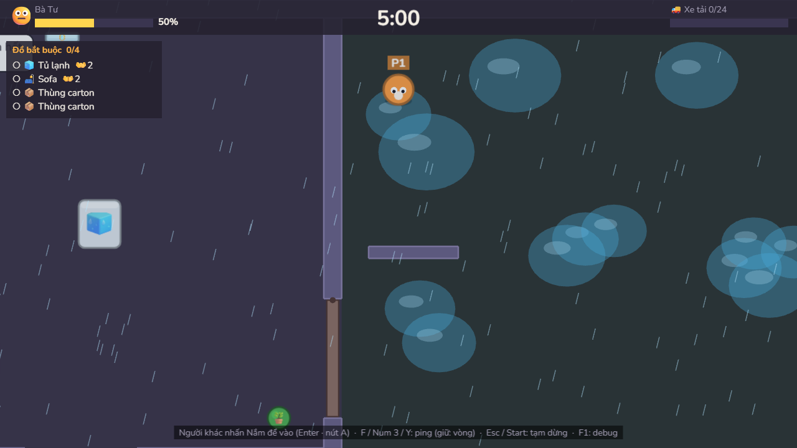
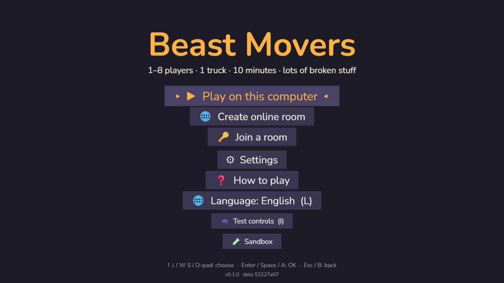
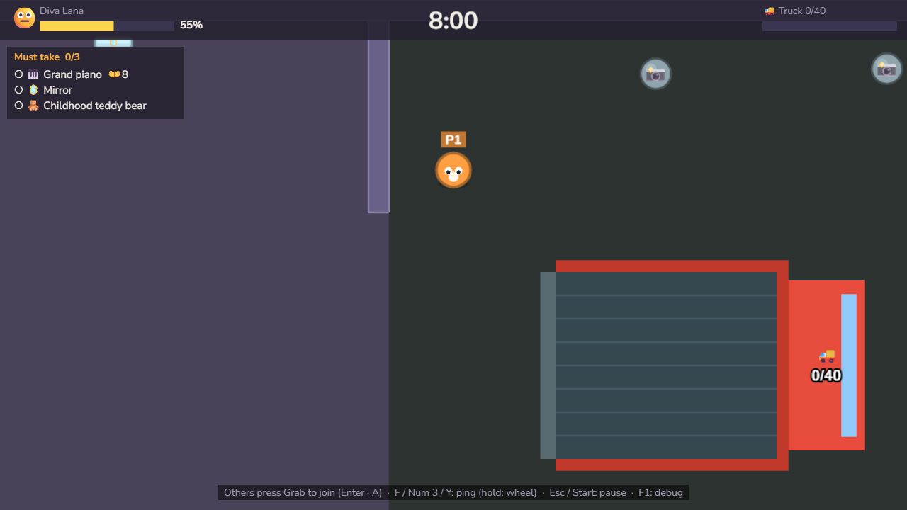

# Beast Movers

Game co-op chuyển nhà 1–8 người, chơi ngay trên trình duyệt, không cần cài đặt.
Hỗ trợ **tiếng Anh** và **tiếng Việt**.

_Co-op moving chaos for 1–8 players, right in your browser. Available in English and Vietnamese._

### ▶ [Chơi ngay / Play now](https://luongquochung1995.github.io/beastmovers/)



|                                  |                                                          |
| -------------------------------- | -------------------------------------------------------- |
|  |  |

**Cách chơi trong 30 giây**

1. Mở link, chọn **Chơi chung máy** (1–4 người: bàn phím + tay cầm) hoặc **Tạo phòng online**
   (tối đa 8 người) rồi bấm **Copy link mời** gửi cho bạn bè — bạn mở link là vào phòng.
2. Đưa hết **Đồ bắt buộc** lên xe tải trước khi hết giờ. Đồ to ghi `👐 4` là cần 4 người cùng nắm.
3. Đừng làm vỡ đồ — chủ nhà đang nhìn. Gọi đồng đội bằng **Ping** (giữ để mở vòng ping).

16 màn từ 1 tới 8 người · 5 chủ nhà lắm lời · mèo chạy trốn · tủ lạnh trượt · mưa, dốc, cầu thang,
paparazzi · chơi được trên điện thoại (cầm ngang) · không cần tài khoản, không có server riêng.

Thay đổi theo phiên bản: [CHANGELOG.md](CHANGELOG.md) · Kế hoạch và tiến độ: [docs/PLAN.md](docs/PLAN.md) ·
Chơi thử và cân bằng: [docs/PLAYTEST.md](docs/PLAYTEST.md) · Trang itch.io: [docs/ITCH.md](docs/ITCH.md).

## Yêu cầu

- Node.js 22+

## Chạy khi phát triển

```bash
npm install
```

```bash
npm run dev
```

Mở địa chỉ Vite in ra (mặc định http://localhost:5173). Tham số URL hữu ích:

- `?debug=1`: bật chế độ debug
- `?lang=en` hoặc `?lang=vi`: chọn ngôn ngữ

## Build bản phát hành

```bash
npm run build
```

Kết quả nằm trong `dist/`: toàn file tĩnh, đưa lên GitHub Pages, Netlify hay itch.io đều chạy (dùng đường dẫn tương đối).

```bash
npm run preview
```

## Lệnh khác

| Lệnh                | Việc                      |
| ------------------- | ------------------------- |
| `npm test`          | Chạy unit test (Vitest)   |
| `npm run lint`      | Kiểm tra code (ESLint)    |
| `npm run typecheck` | Kiểm tra kiểu TypeScript  |
| `npm run format`    | Định dạng code (Prettier) |

## Điều khiển hiện tại

Tối đa 4 người trên một máy: 2 người chung bàn phím + tay cầm (Gamepad API). Ai chưa vào thì nhấn **Nắm** để tham gia, kể cả giữa màn.

| Hành động      | Người WASD | Người mũi tên         | Tay cầm          |
| -------------- | ---------- | --------------------- | ---------------- |
| Di chuyển      | W A S D    | Mũi tên               | Cần trái / D-pad |
| Nắm / tham gia | Space      | Enter / Numpad 0      | A                |
| Ném            | E          | Shift phải / Numpad 1 | B                |
| Lao            | Q          | Ctrl phải / Numpad 2  | X                |
| Ping           | F          | Numpad 3              | Y                |

Giữ một hướng khoảng 0,6 giây thì nhân vật chuyển sang chạy (chạy có thể vấp ngã). Lao vào người khác làm họ ngã.
Đồ một người cầm được (thùng, gương, mèo…) thì **đỡ lên đầu bằng hai tay**; đồ to vẫn khiêng nhiều người. Đưa hết đồ bắt buộc lên xe thì hiện nút **🚚 Đủ đồ rồi — cho xe chạy!** để kết thúc sớm (online: chỉ host).
Giữ **Ping** + một hướng để mở vòng ping. **Lao tốn mana**: thanh xanh dưới chân, mỗi lần lao tốn 40/100,
hồi 20 mỗi giây (vạch trắng = đủ cho một lần lao); thiếu mana thì không lao được (💤). Chỉnh trong
`config.json` (`maxMana`, `dashManaCost`, `manaRegenPerSec`).

**Điện thoại / máy tính bảng** (cầm ngang): đặt ngón tay ở nửa trái màn hình là có cần ảo; nút
**Nắm / Ném / Lao / Ping** bên phải, nút ⏸ góc trên. Mỗi điện thoại một người — rủ bạn chơi online
bằng link mời. Menu, chọn màn, lobby, kết quả đều bấm được bằng tay; chạm vào ô mã phòng để gõ mã.

| Phím chung  | Việc                                                       |
| ----------- | ---------------------------------------------------------- |
| ↑ ↓ Enter   | Chọn trong menu (tay cầm: D-pad + A, B quay lại)           |
| I           | Màn thử điều khiển (ở menu)                                |
| L           | Đổi ngôn ngữ English ↔ Tiếng Việt (ở menu)                 |
| Esc / Start | Tạm dừng trong màn / quay lại                              |
| F1          | Bật/tắt debug (FPS, số bước logic mỗi giây, khung va chạm) |
| T           | Khi bật debug: cho mọi người vấp ngã                       |

## Sandbox

Bảng bên trái liệt kê mọi món đồ trong `items.json`. Click để đặt, chuột phải để xóa, lăn chuột hoặc `[` `]` để chọn, `C` để xóa hết. Phím `1`–`0` chạy sẵn 10 cảnh thử hành vi (tủ lạnh bật cửa, bể cá tràn, máy chạy bộ hất người…).

Khi chơi: đứng gần món đồ (có viền sáng và chấm ở điểm nắm) rồi bấm **Nắm**; bấm lại để thả; **Ném** để ném đồ nhẹ. Đồ cần nhiều người hiện bộ đếm `x/y 👐`. Bắt mèo: lao vào cho mèo choáng, nắm lấy, mang tới lồng mèo rồi thả (thùng carton thì mèo có thể nhảy ra).

## Thêm hoặc sửa ngôn ngữ

- Mọi chữ hiển thị nằm trong `public/data/i18n/<mã>.json`, dạng khóa phẳng (`"menu.start": "…"`), tham số viết `{ten}`.
- Thêm ngôn ngữ mới: tạo file JSON cùng bộ khóa với `en.json` và thêm mã vào `LOCALES` trong `src/data/i18n.ts`.
- `npm test` kiểm tra mọi file ngôn ngữ có đủ khóa, đúng tham số, và mọi khóa dùng trong code đều tồn tại.
- Ngôn ngữ được chọn theo thứ tự: `?lang=` → lựa chọn đã lưu → ngôn ngữ trình duyệt → tiếng Anh.

## Cấu trúc

```
public/data/        Dữ liệu game (JSON)
public/data/i18n/   Chữ hiển thị theo ngôn ngữ (en.json, vi.json)
src/scenes/         Boot, Menu, InputTest, Game, Result
src/systems/        Logic game (vòng lặp cố định 60 Hz, input, di chuyển…)
src/entities/       Nhân vật, đồ vật, mèo, chủ nhà, xe tải
src/net/            Chơi online
src/data/           Kiểu dữ liệu, đọc JSON, i18n, cài đặt
src/ui/             HUD, menu, overlay
tests/              Unit test
```

## Deploy GitHub Pages

Workflow `.github/workflows/deploy.yml` mỗi khi push lên nhánh `main`: lint, test, build rồi đẩy
thư mục `dist/` lên nhánh `gh-pages`.
Trên GitHub, vào **Settings → Pages → Build and deployment**, chọn **Source: Deploy from a branch**,
nhánh **gh-pages**, thư mục **/ (root)**.
